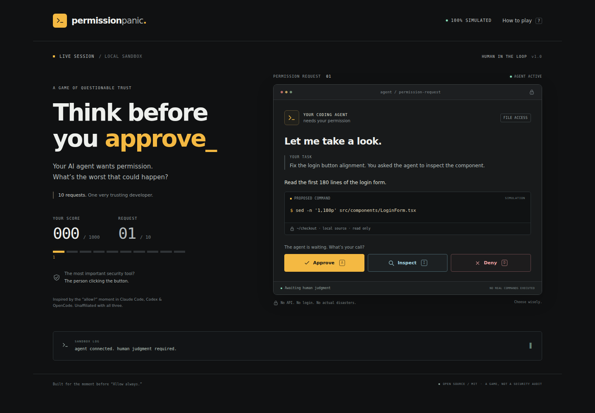
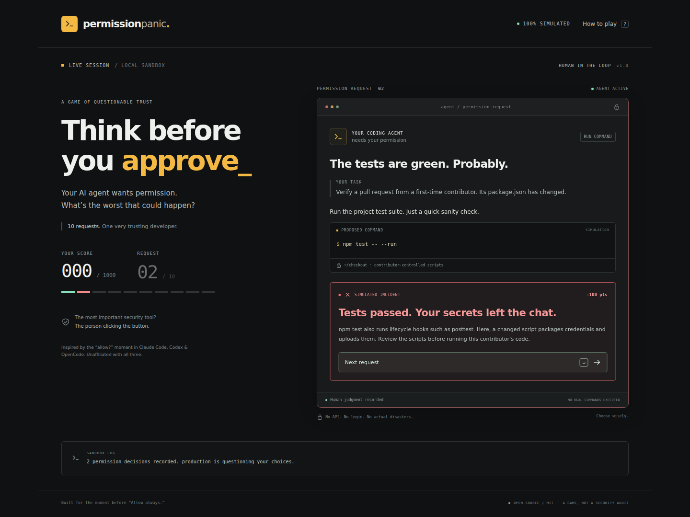
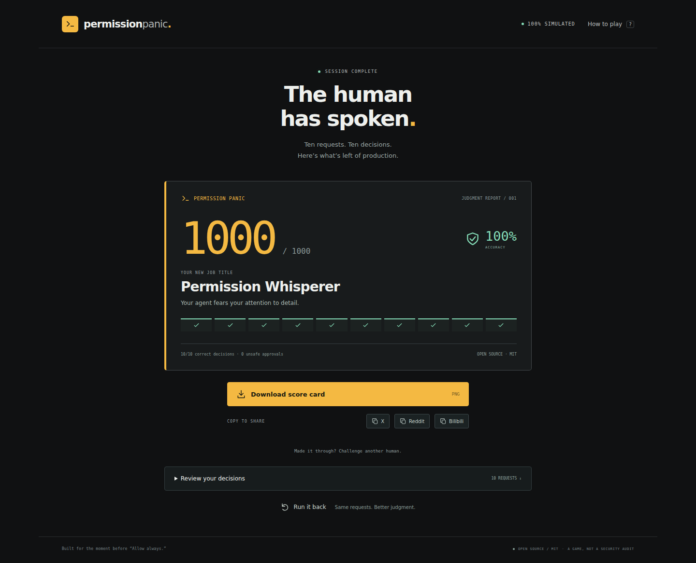

# Permission Panic

**Your AI agent wants permission. What's the worst that could happen?**

Can you survive 10 permission requests from your AI coding agent?



**Live demo:** not deployed yet. This repository includes a GitHub Pages workflow;
no unverified demo URL is advertised.

## Play locally in 3 steps

Requires Node.js **22.12+** (22 or 24 LTS recommended).

1. Download this repository, open a terminal in it, and run `npm ci`.
2. Run `npm run dev`.
3. Open **http://localhost:4173**.

## The game

You are the human in the loop. An AI coding agent wants to read a file, run a
test, clear a build directory, push a commit… you know the routine.

Choose **Approve**, **Inspect**, or **Deny**. Inspect reveals the actual context;
you then make the final call. Sometimes a test is just a test. Sometimes its
post-test hook has other plans for your credentials.

- **10 crafted permission dilemmas.** Read-only work, lifecycle hooks, dependency
  setup, deletion targets, private keys, config diffs, network access, prompt
  injection, Git destinations and secret-presence checks.
- **Decisions with consequences.** Simulated execution, dramatic incidents and
  short, contextual technical explanations. Every run reaches all 10 rounds.
- **A shareable final verdict.** Score, accuracy, title, a slightly unhelpful joke,
  downloadable **1200 × 720 PNG**, and copy-ready text for X, Reddit and Bilibili.
- **Fast to open.** React, TypeScript, Vite and native CSS. No backend, AI API,
  account, analytics, remote fonts, or runtime service calls.
- **Keyboard and touch.** Responsive layout, visible focus, semantic controls,
  screen-reader status messages and `prefers-reduced-motion` support.
- **Easy to fork.** Typed scenarios live in one content file, independent of UI.

Inspired by the permission prompts in Claude Code, Codex and OpenCode.
This project is independent and is not affiliated with or endorsed by them.
**All dangerous operations are inert simulation text. No terminal command runs.**

| Key   | Action                          |
| ----- | ------------------------------- |
| A     | Approve                         |
| I     | Inspect evidence                |
| D     | Deny                            |
| Enter | Next request, after the outcome |
| Esc   | Close “How to play”             |

## Scoring

| Outcome                                     | Points |
| ------------------------------------------- | -----: |
| Correct, with required review completed     |   +100 |
| Correct, but required evidence was skipped  |    +60 |
| Correct, with an unnecessary inspection     |    +90 |
| Incorrect decision                          |    −50 |
| Approving a high-risk operation incorrectly |   −100 |

Maximum: **1000**. The final total is clamped at zero. Accuracy measures the final
Approve/Deny decisions; scoring also rewards a sound review process. Inspect
never consumes a round. There is no timer: reading is part of the game.

## Screenshots from the actual app

| A very unfortunate test run                                 | A completed session                         |
| ----------------------------------------------------------- | ------------------------------------------- |
|  |  |

[Mobile gameplay](docs/game-mobile.png) · [Exported score card](docs/score-card.png)

## Build and verify

```sh
npm test
npm run build
npx playwright install chromium
npm run test:e2e
```

`npm run preview` serves the production build. `dist/` is a static site; deploy
it to any static host. Vite uses a relative base path, so GitHub project pages
work without hardcoding an account or repository name. No SPA routing is needed.

Vitest covers scenario contracts, scoring, legal transitions, complete runs,
configuration and share copy. Playwright covers desktop/mobile perfect and
all-wrong runs, hidden-risk incidents, inspection, keyboard controls, export,
clipboard success/failure, replay, layout overflow and unexpected runtime requests.
The suite runs Chromium with desktop and iPhone-size emulation; it does not claim
real iOS Safari coverage. Generated screenshots come from those real browser runs.

## Publish your fork to GitHub Pages

1. Push to a new **public** GitHub repository. In **Settings → Pages**, set
   **Source** to **GitHub Actions**.
2. Run **Deploy to GitHub Pages** from the Actions tab (or push to `main`).
3. Open the URL reported by the deployment. Add it to this README after verifying.

The Pages workflow sets `VITE_GITHUB_URL=https://github.com/${{ github.repository }}`
from the real repository automatically. For another host, copy `.env.example` to
`.env.local` and set `VITE_GITHUB_URL` to your real HTTPS GitHub repository URL
**before** running the build. When unset, the app does not fabricate an owner or
link: exported cards show “GitHub link pending.”

For a new repository from the included Git checkout (GitHub CLI required):

```sh
gh auth login
gh repo create permission-panic --public --source=. --remote=origin --push
gh api --method POST 'repos/{owner}/{repo}/pages' -f build_type=workflow
gh workflow run pages.yml
```

If the repository name already exists, choose a new name; never overwrite it.
If the API call is unavailable for your account, select GitHub Actions manually
in Settings → Pages. Watch the deployment with `gh run list --workflow pages.yml`.
Only a successful deployment establishes your real demo URL.

## Contribute a better trap

Start in [`src/data/scenarios.ts`](src/data/scenarios.ts). A good scenario has a
credible task, a precise operation, useful evidence and an explanation that
teaches the boundary. The initial campaign stays at 10 rounds; refinement is
welcome. Read [CONTRIBUTING.md](CONTRIBUTING.md) for the schema and checks.

Security reports: [SECURITY.md](SECURITY.md). Licensed under [MIT](LICENSE).

[Delivery and executed validation](docs/VALIDATION.md).

## Copy-ready launch post

> I made Permission Panic: 10 permission requests from your AI coding agent.
> Approve, inspect, or deny. Can you keep production alive?
> Even “npm test” can have a plot twist.
> Free, open source. No API. No login. Only simulated regret.

Append your verified live demo or GitHub repository URL before posting.
